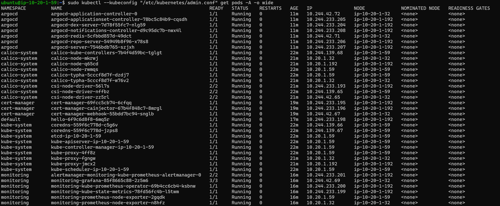
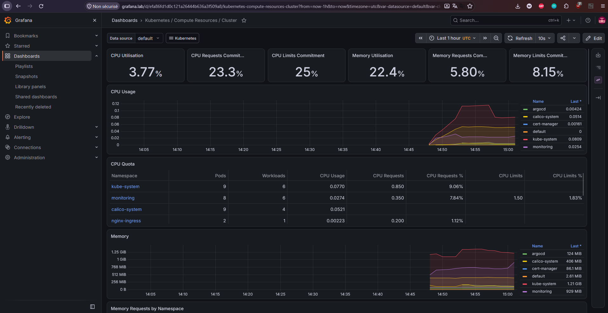
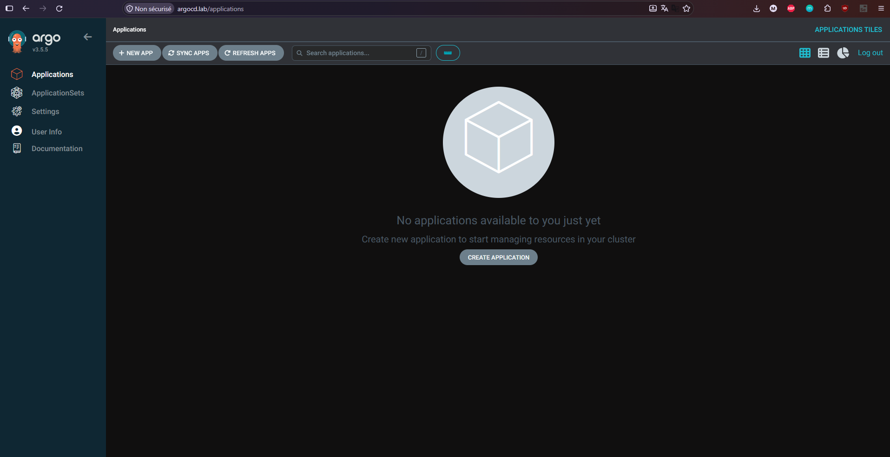
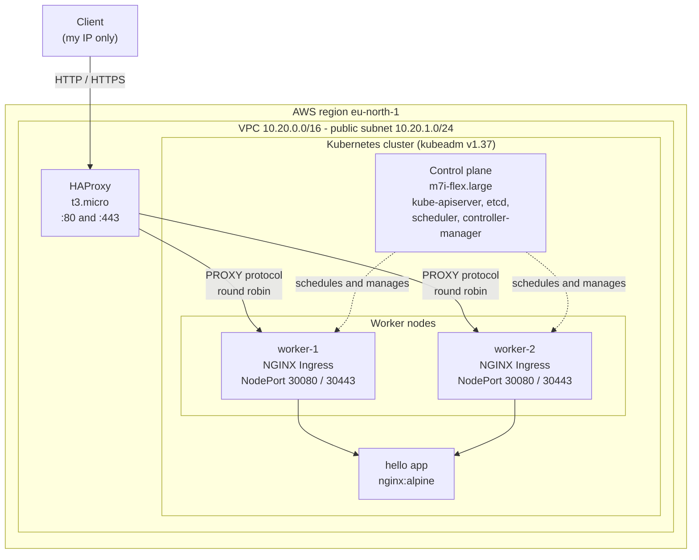
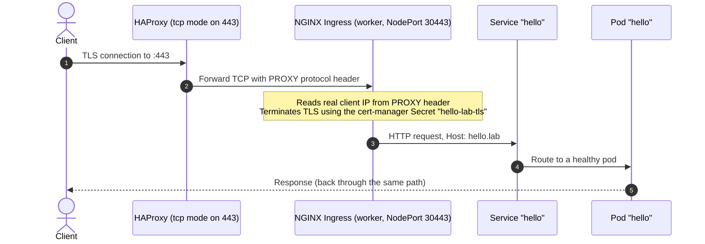
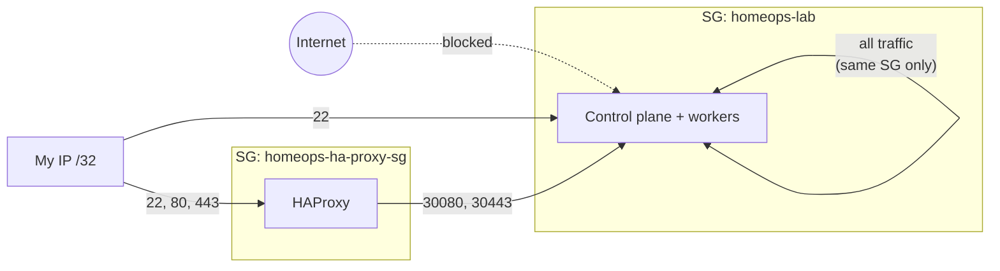

# OpsPlatform Homelab

A multi-node Kubernetes cluster on AWS, built entirely as code. **Terraform** provisions the network and servers, **Ansible** turns them into a **kubeadm** cluster, and an **HAProxy** edge load balancer routes traffic to an **NGINX Ingress Controller** with **cert-manager**-issued TLS.

I built this to learn how the pieces of a platform fit together by assembling them myself, instead of using a managed service like EKS.






---

## Table of contents

- [What this project demonstrates](#what-this-project-demonstrates)
- [Architecture](#architecture)
- [Request flow](#request-flow)
- [Provisioning workflow](#provisioning-workflow)
- [Network security model](#network-security-model)
- [Monitoring](#monitoring)
- [Tech stack](#tech-stack)
- [Repository layout](#repository-layout)
- [Getting started](#getting-started)
- [Verifying the deployment](#verifying-the-deployment)
- [Design decisions](#design-decisions)
- [Known limitations](#known-limitations)
- [Roadmap](#roadmap)
- [Teardown](#teardown)

---

## What this project demonstrates

| Area | What I built |
|---|---|
| **Infrastructure as Code** | Terraform with a reusable `network` module and an `ha-proxy` module, composed by a `lab` environment. Typed variables, input validation, outputs, pinned provider version. |
| **Configuration management** | Idempotent Ansible playbooks: OS preflight checks, containerd and kernel/sysctl configuration, Kubernetes package install and version hold, cluster init and worker join. |
| **Kubernetes internals** | Manual `kubeadm` bootstrap (1 control plane, 2 workers), containerd with the systemd cgroup driver, Calico CNI with NetworkPolicy enforcement, swap disabled, kernel modules and sysctls configured. |
| **Edge networking** | HAProxy load balancer in front of NodePort-exposed ingress, with PROXY protocol so the original client IP reaches NGINX. |
| **TLS automation** | cert-manager installed with Helm, issuing a certificate from a self-signed `Issuer` for the sample app. |
| **Observability** | Prometheus and Grafana monitor the cluster and nodes; Grafana is exposed through the restricted F5 Ingress with self-signed TLS. |
| **Network security** | Least-privilege security groups: SSH and web access limited to my IP, NodePorts reachable only from the HAProxy security group, Kubernetes API never exposed publicly. |
| **Automation scripting** | A Bash script that reads Terraform outputs and generates the Ansible inventory, so IPs are never typed by hand. |

---

## Architecture



**Cluster components**

| Component | Detail |
|---|---|
| Container runtime | containerd 2.x, systemd cgroup driver |
| CNI and network policy | Calico `v3.33.0`, VXLAN encapsulation, pod CIDR `10.244.0.0/16`; supports Kubernetes NetworkPolicy enforcement |
| Ingress | F5 NGINX Ingress Controller (Helm chart `2.8.0`) as a DaemonSet, NodePort `30080` / `30443` |
| Certificates | cert-manager `v1.21.0` (Helm, CRDs enabled) |
| Monitoring | Prometheus and Grafana via `kube-prometheus-stack` chart `92.10.1`; Prometheus and Grafana use ClusterIP services, with Grafana exposed through the restricted F5 Ingress and self-signed TLS |
| OS | Ubuntu 24.04 LTS |

---

## Request flow

How an HTTPS request reaches the application:



Plain HTTP on port 80 follows the same path through HAProxy's HTTP frontend, and NGINX answers with a redirect to HTTPS (`nginx.org/redirect-to-https`).

---

## Provisioning workflow

```mermaid
flowchart LR
    subgraph tf["1. Terraform"]
        A["terraform apply<br/>VPC, subnet, IGW, routes,<br/>security groups, 4 EC2 instances"]
    end

    subgraph sh["2. Bash"]
        B["create_ansible_inventory.sh<br/>reads terraform outputs and<br/>writes ansible/inventory.ini"]
    end

    subgraph an["3. Ansible playbooks, in order"]
        direction TB
        C["bootstrap.yml<br/>preflight, swap off, containerd,<br/>sysctls, kubeadm packages"]
        D["init-control-plane.yml<br/>kubeadm init + Calico"]
        E["init-workers.yml<br/>kubeadm join"]
        F["configure-ha-proxy.yml<br/>install + template haproxy.cfg"]
        G["f5-nginx-controller.yml<br/>Helm + NGINX Ingress"]
        H["cert-manager.yml<br/>Helm install"]
        I["hello-selfsigned-certificate.yml<br/>Issuer + Certificate"]
        J["nginx-deploy-manifest.yml<br/>Deployment, Service, Ingress"]
        K["monitoring.yml<br/>Prometheus + Grafana"]
        C --> D --> E --> F --> G --> H --> I --> J --> K
    end

    A --> B --> C
```



**Idempotence:** commands that aren't naturally idempotent are guarded so a second run changes nothing. `kubeadm init` uses `creates: /etc/kubernetes/admin.conf`, and `kubeadm join` uses `creates: /etc/kubernetes/kubelet.conf`. The `changed_when` conditions on `kubectl apply` tasks report real changes only, and the HAProxy config is validated with `haproxy -c` before it is applied.

---

## Network security model



| Security group | Inbound rule | Source |
|---|---|---|
| HAProxy | TCP 22 (SSH) | `allowed_ssh_cidr` (my IP) |
| HAProxy | TCP 80, 443 | `allowed_ingress_cidr` (my IP) |
| Nodes | TCP 22 (SSH) | `allowed_ssh_cidr` (my IP) |
| Nodes | TCP 30080, 30443 (NodePorts) | **HAProxy security group only** |
| Nodes | All protocols | Nodes' own security group (node-to-node and pod traffic) |

The Kubernetes API (6443) is not open to the internet, and the HAProxy instance requires IMDSv2 (`http_tokens = required`). The `allowed_ingress_cidr` variable has a validation rule that rejects anything other than a single `/32` address.

---

## Tech stack

**Cloud:** AWS (EC2, VPC, security groups, EBS gp3)
**IaC:** Terraform `>= 1.1`, AWS provider `~> 6.0`
**Config management:** Ansible (collections: `ansible.posix`, `community.general`, `kubernetes.core`)
**Kubernetes:** kubeadm, containerd, Calico, Helm
**Monitoring:** Prometheus, Grafana, Alertmanager, node-exporter, kube-state-metrics
**Edge and TLS:** HAProxy, F5 NGINX Ingress Controller, cert-manager
**Scripting and linting:** Bash, yamllint

---

## Repository layout

```text
.
├── terraform/
│   ├── modules/
│   │   ├── network/          # VPC, public subnet, IGW, route table, node security group
│   │   └── ha-proxy/         # HAProxy instance + its security group and worker NodePort rules
│   └── environments/
│       └── lab/              # Deployable environment: control plane, workers, variables, outputs
├── ansible/
│   ├── playbooks/            # bootstrap, kubeadm init/join, HAProxy, ingress, cert-manager, app, monitoring
│   ├── templates/
│   │   └── haproxy.cfg.j2    # HAProxy config, backends generated from the worker inventory group
│   └── inventory.ini         # Generated by the script below (not meant to be edited by hand)
├── Kubernetes/
│   ├── nginx.yml             # Sample app: Deployment, Service, Ingress (TLS)
│   ├── grafana-ingress.yml   # Grafana self-signed Certificate and Ingress
│   └── cert-manager-selfsigned.yml   # Self-signed Issuer + Certificate
├── Scripts/
│   └── create_ansible_inventory.sh   # Terraform outputs -> Ansible inventory
└── docs/
    ├── control_plane_init.md # Verified control-plane status and evidence
    └── images/
```

## Monitoring

After cert-manager is installed, run the monitoring playbook from the repository root. It prompts twice for a Grafana admin password (minimum 16 characters), creates/updates the Kubernetes Secret, installs the pinned Helm chart, and applies the Grafana self-signed Certificate and Ingress. Grafana, Prometheus, and Alertmanager remain ClusterIP services; Grafana is reachable through the existing F5 Ingress and HAProxy entry point, not a new NodePort or AWS load balancer.

```bash
ansible-playbook -i ansible/inventory.ini ansible/playbooks/monitoring.yml
```

Prometheus uses ephemeral storage with a seven-day retention limit because this cluster has no persistent volume provisioner configured. Its metrics are lost if its pod is recreated. Grafana persistence is also disabled, so configure persistent storage before relying on saved dashboard changes. The `grafana.lab` self-signed certificate is not publicly trusted; use `curl -k` or explicitly trust the certificate on your client.

Map `grafana.lab` to the HAProxy public IP on your workstation (for example, add `<HAProxy-public-IP> grafana.lab` to the Windows hosts file at `%SystemRoot%\System32\drivers\etc\hosts`). The HAProxy security group restricts HTTPS access to the configured allowed ingress CIDR.

Open Grafana at `https://grafana.lab` and sign in as `admin` with the password entered during installation. To check the certificate with curl:

```bash
curl -kI https://grafana.lab
```

---

## Getting started

### Prerequisites

- AWS account and CLI credentials (use an IAM user or role with MFA, not root)
- An existing EC2 key pair in your chosen region
- Terraform `>= 1.1`
- Ansible with the required collections:
  ```bash
  ansible-galaxy collection install ansible.posix community.general kubernetes.core
  ```
- Your public IP address, in `/32` form

> **Cost warning:** this lab runs 4 EC2 instances plus EBS volumes and public IPv4 addresses. Set an AWS Budget alert first, and destroy the lab when you're not using it.

### 1. Provision the infrastructure

```bash
cd terraform/environments/lab
cp terraform.tfvars.example terraform.tfvars
# Edit terraform.tfvars: AMI ID, key pair name, your /32 IP in both CIDR variables

terraform init
terraform fmt -check
terraform validate
terraform plan
terraform apply
```

### 2. Generate the Ansible inventory

The script reads the Terraform outputs. Adjust `SSH_KEY` at the top of the script to point at your own private key first.

```bash
./Scripts/create_ansible_inventory.sh
```

### 3. Configure the cluster

Run from the `ansible/` directory, in this order:

```bash
cd ansible
ansible-playbook -i inventory.ini playbooks/bootstrap.yml
ansible-playbook -i inventory.ini playbooks/init-control-plane.yml
ansible-playbook -i inventory.ini playbooks/init-workers.yml
ansible-playbook -i inventory.ini playbooks/configure-ha-proxy.yml
ansible-playbook -i inventory.ini playbooks/f5-nginx-controller.yml
ansible-playbook -i inventory.ini playbooks/cert-manager.yml
ansible-playbook -i inventory.ini playbooks/hello-selfsigned-certificate.yml
ansible-playbook -i inventory.ini playbooks/nginx-deploy-manifest.yml
ansible-playbook -i inventory.ini playbooks/monitoring.yml
```

The monitoring playbook prompts for a Grafana admin password. Re-run any playbook a second time to check idempotence; the monitoring playbook will prompt for the same Grafana password again.

---

## Verifying the deployment

On the control plane (SSH in using the IP from `terraform output`):

```bash
export KUBECONFIG=/etc/kubernetes/admin.conf

kubectl get nodes -o wide                  # 1 control plane + 2 workers, all Ready
kubectl get pods -A                        # system, ingress and cert-manager pods Running
kubectl get certificate hello-lab-tls      # READY = True
kubectl get ingress hello
```

From your workstation (the hostname `hello.lab` isn't real DNS, so pin it to the HAProxy IP):

```bash
PROXY_IP=$(terraform -chdir=terraform/environments/lab output -raw ha_proxy_public_ip)

curl -kI https://hello.lab --resolve "hello.lab:443:${PROXY_IP}"
curl -I  http://hello.lab  --resolve "hello.lab:80:${PROXY_IP}"   # expect a redirect to HTTPS
```

`-k` is needed because the certificate is self-signed.

---

## Design decisions

- **kubeadm instead of K3s or EKS.** I wanted to see what a managed distribution hides: container runtime setup, cgroup drivers, CNI choice, certificates and the join process.
- **HAProxy outside the cluster.** It gives the cluster a single entry point without a cloud load balancer, and shows how an external edge forwards to NodePorts. PROXY protocol keeps the real client IP visible to NGINX.
- **Terraform modules split by concern.** `network` and `ha-proxy` are modules, while the lab instances stay in the environment because there is only one environment. A node module would be the next extraction if the topology grew.
- **Security groups reference each other** instead of using CIDR ranges. Workers accept NodePort traffic from the HAProxy group, not from an IP range.
- **Inventory is generated, not written.** Instance IPs change on every rebuild, so a script builds the inventory from Terraform outputs.
- **Ansible `command` tasks are guarded.** `creates:` and `changed_when` keep the playbooks idempotent where no native module exists.

---

## Roadmap

- [ ] GitHub Actions: `terraform fmt/validate`, `ansible-lint`, `yamllint` on every push
- [ ] Add and test Kubernetes NetworkPolicy manifests for the sample application
- [ ] Configure persistent storage for Prometheus and Grafana
- [ ] Let's Encrypt staging issuer with a real domain and DNS
- [ ] Argo CD for GitOps-managed application deployment
- [ ] Configure and test alert notifications for node readiness, disk pressure, and certificate expiry
- [ ] Resource requests/limits and probes on the sample app
- [ ] Migrate ingress to Gateway API (NGINX Gateway Fabric)
- [ ] SSM access instead of SSH, with private subnets

---

## Teardown

```bash
cd terraform/environments/lab
terraform plan -destroy     # review what will be removed
terraform destroy
```

After destroying, check the AWS console for leftover EBS volumes, snapshots or Elastic IPs.