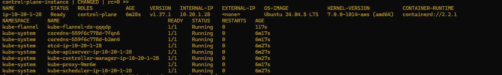

# Kubernetes control plane

The kubeadm control plane is running on the lab EC2 instance. This is a
single-node cluster for learning; worker nodes have not been added yet.

## Verified status

Checked on 2026-10-16:

- Node `ip-10-20-1-28` is `Ready` at private IP `10.20.1.28`.
- Kubernetes version: `v1.37.1`.
- OS: Ubuntu 24.04.5 LTS.
- Container runtime: containerd `2.2.1`.
- Flannel, CoreDNS, etcd, and the Kubernetes control-plane pods were `Running`.

## Evidence

The screenshot below records the node and pod status from the verification
command.

